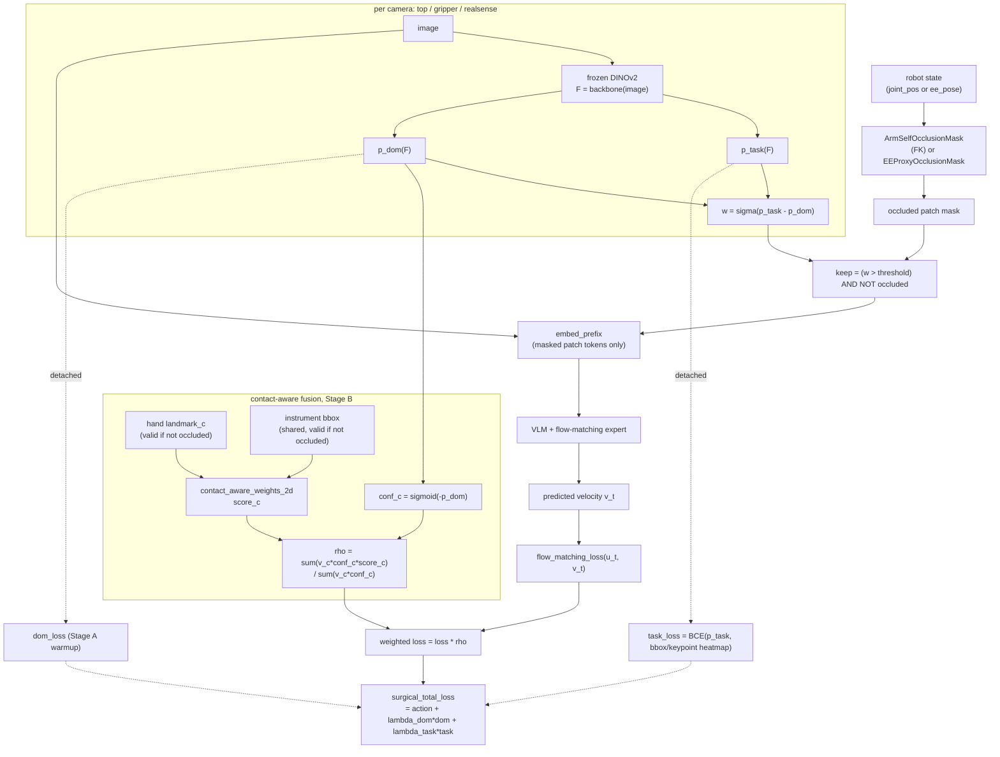

# SurgicalVLA

Surgical Vision-Language-Action (VLA) model for robotic surgery, built on top of [LeRobot](https://github.com/huggingface/lerobot) 0.6.1.

## Overview

SurgicalVLA is a vision-language-action models applied to surgical robotics. It provides modular components for data loading, model definition, training, and evaluation.

## Installation

Requires Python 3.12.

### With uv

```bash
uv sync
```

This creates a virtual environment and installs the package in editable mode along with
`lerobot==0.6.1` and all dependencies.

### With pip

```bash
pip install -e .
```

## Project Structure

```
SurgicalVLA/
├── configs/                 # YAML/config files for experiments
├── scripts/                 # Entry-point scripts (train, evaluate)
├── src/surgicalvla/
│   ├── __init__.py          # Package init / version
│   ├── modules/             # Neural network components (policies, normalizers)
│   ├── data/                # Dataset loading and preprocessing
│   ├── utils/               # Config, checkpoint IO, visualization
│   ├── training/            # Training loops, losses, trainers
│   └── evaluation/          # Metrics, rollouts, evaluation harness
└── tests/                   # Pytest test suite
```

## Usage

```python
import surgicalvla

from surgicalvla.data import (
    get_dataset,
    get_pretrain_dataset,
    get_streaming_dataset,
    get_streaming_pretrain_dataset,
)
from surgicalvla.modules import SurgicalSmolVLAConfig, SurgicalSmolVLAPolicy, build_surgical_policy
from surgicalvla.training import train_base_stage, train_surgical_stage
from surgicalvla.utils.config import build_surgical_config, load_config
from surgicalvla.evaluation import evaluate, rollout_policy
```

### Training

Two-stage pipeline: Stage A pretrains on the bimanual `double_piper` dataset,
Stage B finetunes on the single-Piper surgical dataset. By default datasets are
loaded locally via `LeRobotDataset` (map-style, random access). For large Hub
repos, pass `--streaming` to train from `StreamingLeRobotDataset` (streamed
frames, no full download; internal `buffer_size` shuffling).

```bash
# Stage A: bimanual pretrain
uv run python scripts/train.py --stage base --config configs/train.yaml \
    --dataset ~/datasets/double_piper --steps 30000 --batch_size 32

# Stage A: stream the same (or a Hub) dataset instead of downloading it
uv run python scripts/train.py --stage base --config configs/train.yaml \
    --dataset myorg/double_piper --streaming --steps 30000 --batch_size 32

# Stage B: surgical finetune (needs Stage-A checkpoint)
uv run python scripts/train.py --stage surgical --config configs/train.yaml \
    --dataset ~/datasets/my_surgical_task --base_checkpoint checkpoints/stage_a.pt \
    --steps 3000 --batch_size 16
```

### Evaluation

```bash
uv run python scripts/evaluate.py --config configs/train.yaml \
    --dataset ~/datasets/my_surgical_task --checkpoint checkpoints/stage_b_step1000.pt
```

### Programmatic workflow

```python
from surgicalvla.utils.config import build_surgical_config

config = build_surgical_config("configs/train.yaml")

# Stage A
policy = train_base_stage(
    config,
    dataset_repo_id="~/datasets/double_piper",
    steps=30_000, batch_size=32, device="cuda",
    ckpt_dir="./checkpoints",
)

# Stage B (finetune)
policy = train_surgical_stage(
    config,
    base_checkpoint="./checkpoints/stage_a.pt",
    surgical_dataset_dir="~/datasets/my_surgical_task",
    steps=3_000, batch_size=16, device="cuda",
    ckpt_dir="./checkpoints",
)
```
## What flows through the policy

Two objects matter: `SurgicalSmolVLAPolicy` (the outer wrapper LeRobot calls `.forward()` on) and `SurgicalVLAFlowMatching` (`policy.model`, the actual network — subclasses SmolVLA's `VLAFlowMatching`).

**Per training step, in order:**

1. **Per-camera image → gate.** For each camera in the batch, `UncertaintyGate` runs a frozen DINOv2 backbone to get patch features `F`, then two tiny trainable MLP heads: `p_task(F)` (task-relevance logit) and `p_dom(F)` (domain/occlusion-uncertainty logit). The gate weight is `w = σ(p_task − p_dom)` — high only where a patch is both task-relevant *and* not flagged as a dynamic/occluded distractor. This is the direct WildGS-SLAM analog: their β plays the same "how much do I trust this pixel" role in both their tracking loss and render loss.

2. **Token masking.** `SurgicalVLAFlowMatching._gate_image_mask` combines two independent masks before the image ever reaches the VLM: `w > token_keep_threshold` (learned, from the gate) AND `not arm_self_occlusion` (deterministic FK-projected mask, or the EE-proxy segment mask if you're in `ee_pose` space). Only surviving patch tokens get embedded — this happens inside `embed_prefix`, so occluded/uncertain patches never enter the VLM's attention at all, they're not just down-weighted later.

3. **VLM + flow-matching expert.** Whatever tokens survive go through SmolVLA's usual prefix embedding → VLM → flow-matching expert, which predicts the denoising velocity `v_t` against target `u_t` (unchanged from stock SmolVLA/`VLAFlowMatching`).

4. **Contact-aware reweighting (Stage B only).** `SurgicalSmolVLAPolicy._contact_aware_weights` computes, per camera, a proximity score between the hand landmark and the instrument bbox, gated by that camera's own `UncertaintyGate.confidence()`, then fuses across cameras: `ρ = Σ(v_c·conf_c·score_c) / Σ(v_c·conf_c)` — occluded cameras (`v_c=0`) drop out of the sum rather than corrupting one global weight. The final action loss is `per_sample_loss * ρ`.

5. **Gate training (parallel, detached).** `UncertaintyGate.dom_loss` (self-supervised, Stage A warmup) and `.task_loss` (BCE against the bbox/keypoint heatmap, Stage B) train `p_dom`/`p_task` independently of the action loss — no gradient flows from the action loss into the gate, or from the gate losses into the VLM, matching the paper's explicit detach between `L_uncer` and the Gaussian map (Sec. 3.4).



**Stage A vs Stage B, concretely:**

| | Stage A (pretrain) | Stage B (finetune) |
|---|---|---|
| Dataset | bimanual `double_piper`, unsplit | single-Piper surgical, 50–100 episodes |
| `token_keep_threshold` | 0 → gate inert, all tokens kept | ramped via `threshold_at_step` |
| `enable_contact_aware_loss_weighting` | off | on |
| `train_expert_only` | full model trainable | off — state/action head trains from scratch (shapes don't transfer from Stage A) |
| Gate training | `dom_loss` only, self-supervised | `dom_loss` + `task_loss` (bbox/keypoint supervised) |

One gap this exposes: `p_task` never gets supervision during Stage A (no bbox/keypoint labels in the pretrain set), so at the start of Stage B, `w = σ(p_task − p_dom)` is driven almost entirely by an untrained `p_task`. Do you want a short `p_task`-only warmup at the very start of Stage B (freeze `p_dom`, train `p_task` alone on the first N steps) before contact-aware reweighting kicks in, or is that over-engineering for your episode count?
## License

MIT