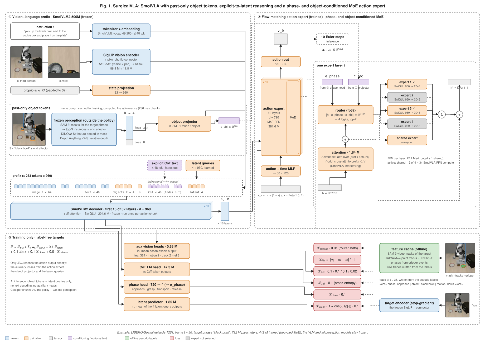

# SurgicalVLA

A Vision-Language-Action model for precision manipulation (target: surgical
instrument handover), built on [LeRobot](https://github.com/huggingface/lerobot)'s
SmolVLA and trained in two stages: supervised flow matching, then online RL with
GRPO over the flow's SDE (ReinFlow-GRPO). Evaluated on **LIBERO** (+ LIBERO-Plus),
**RoboTwin 2.0** and **VLABench**, with one model per benchmark.

> **Status (2026-11-24).** The final architecture (object tokens, auxiliary vision supervision,
> explicit-to-latent reasoning, MoE action expert) is built, is the default of every SFT config,
> and passes an end-to-end check on real weights. **No ablation or benchmark result exists yet**,
> and the evaluation harness is not yet validated against a published number, so nothing here
> is a claim.
> LIBERO evaluation follows a fixed protocol (LeRobot's canonical simulator image, 50-step
> execution horizon; the SmolVLA baseline scores ~66 % on LIBERO-Spatial under it, against ~90 %
> published, see [`docs/baselines.md`](docs/baselines.md)). All new components are
> **experimental** until their ablation passes ([`docs/limitations.md`](docs/limitations.md)).

## Architecture



Interactive figure: [`docs/fig/surgicalvla_arch.html`](docs/fig/surgicalvla_arch.html). Details and measured costs: [`docs/architecture.md`](docs/architecture.md).

| Component | Switch (final default) | Supervision / source |
|---|---|---|
| SmolVLA backbone + flow-matching action expert | — | demonstrations; reproduces `smolvla_base` at init (rel. error < 2e-3) |
| Object tokens (past-only) | `object_input: objects` | frozen SAM 3 + DINOv2 + Depth Anything on the current frame; cached for training, live at inference |
| Action-expert MoE | `moe_variant: upcycled` (also `matched`, `dense` = SmolVLA) | flow matching + load balancing |
| Auxiliary vision heads (training only) | `aux_vision: true` | label-free pseudo-labels (SAM 3 video, DINOv2, TAPNext++, Depth Anything V2), confidence-weighted |
| Latent chain of thought | `latent_cot: true` | future visual latent from an EMA target encoder |
| Explicit chain of thought, explicit-to-latent curriculum | `use_cot`, `aux.cot_traces`, `cot_curriculum_steps` | traces written from pseudo-labels (bootstrapped); latent-only at inference after the curriculum |
| Phase head | with the cache | pseudo phase segments from gripper events and speed minima |
| ReinFlow-GRPO RL, joint SFT+RL | `configs/benchmarks/<b>/rl.yaml`, `training.mode` | task success on LIBERO, RoboTwin 2.0, VLABench |

All features and auxiliary targets come from frozen models run offline on raw demonstrations;
simulator ground truth is used only to validate them and for the oracle ablation. Every
component keeps its switch for the ablations (`configs/ablations/arms.yaml`).

## Install (pixi)

```bash
pixi install -e dev        # training + tests (Python 3.13, torch, LeRobot, editable)
pixi install -e sim-eval   # + LIBERO and the client for Docker-served simulators
pixi run -e dev test       # test suite
```

`lerobot/` is a vendored, unmodified LeRobot checkout (upstream `8ec1a474d`, git-ignored).
RoboTwin, VLABench and LIBERO-Plus run in LeRobot's canonical Docker images
(`lerobot-env-server --docker=true`); the launcher builds/starts/stops them. Docker with
the NVIDIA runtime is required for those.

## Quickstart

```bash
# 1. feature cache (object inputs + pseudo-label targets + traces) for the suites you train on
pixi run -e dev cache --suite libero_spatial            # 57 s/episode; resumable

# 2. one benchmark: SFT (final architecture by default), then RL from that SFT model
pixi run -e dev train sft --benchmark libero             # libero | robotwin | vlabench
pixi run -e dev train rl  --benchmark libero

# 3. evaluate any checkpoint (Hub id at a pinned revision, or a local training dir)
pixi run -e dev eval --benchmark libero --checkpoint lerobot/smolvla_libero \
    --revision a24f1f380461b665158d52acd140152c79e8b36d

# ablations: shared protocol, 3 seeds, train + evaluate (configs/ablations/arms.yaml)
pixi run -e dev ablate --suite libero_spatial --dry-run
pixi run -e dev compare results/ablations/libero_spatial/smolvla results/ablations/libero_spatial/full

# results.json -> vector figures, LaTeX tables, docs/baselines.md tables
pixi run -e dev figures

# full-architecture smoke test on real weights (params, VRAM, step time, latency per module)
pixi run -e dev smoke
# everything: SFT -> RL on every benchmark, then evaluate each model on its benchmark
python3 scripts/benchmark.py pipeline --dry-run
```

Per-benchmark configs live in `configs/benchmarks/<benchmark>/{sft,rl}.yaml` and write to
`outputs/<benchmark>/{sft,rl}`. See [`docs/training.md`](docs/training.md),
[`docs/evaluation.md`](docs/evaluation.md) and [`docs/configs.md`](docs/configs.md). Trained models
are pushed (private) to `Shirish24/surgical-vla-<model-name>` and collected in the Hub collection
`surgical-vla`.

## Results

Each benchmark has its own model; numbers will be reported per benchmark with the
protocols in [`docs/baselines.md`](docs/baselines.md) (multiple seeds, cluster-bootstrap
CIs). Nothing is reported before the ablation pilots finish.

| Benchmark | SmolVLA (reference) | SurgicalVLA SFT | SurgicalVLA SFT + RL |
|---|---|---|---|
| LIBERO (4 suites) | protocol fixed; full run pending | — | — |
| LIBERO-Plus | — | — | — |
| RoboTwin 2.0 (Easy) | baseline training queued | — | — |
| VLABench (primitive / composite) | — | — | — |

## Documentation

- [`docs/audit.md`](docs/audit.md): Phase-0 audit, bugs found and fixed (each with a regression test)
- [`docs/baselines.md`](docs/baselines.md): baseline and ablation inventory, protocols, harness status, generated result tables
- [`docs/architecture.md`](docs/architecture.md): components, switches, MoE variants with measured cost
- [`docs/full_run.md`](docs/full_run.md): full run on one A100: data layout, parallel feature caching of every episode, push to the Hub, parallel SFT
- [`docs/training.md`](docs/training.md): SFT, RL and SFT + RL step by step, per benchmark; when to start RL and the RL experiments; logging, resume, Hub upload
- [`docs/evaluation.md`](docs/evaluation.md): evaluating SFT, RL and SFT + RL models on every benchmark; protocol, statistics, checklist
- [`docs/configs.md`](docs/configs.md): every config key, what it is for and when to change it
- [`docs/pseudolabels.md`](docs/pseudolabels.md) / [`docs/pseudolabel_quality.md`](docs/pseudolabel_quality.md): label-free targets, cost, validation against simulator ground truth
- [`docs/related_work.md`](docs/related_work.md): related work and component licenses (all components release-safe)
- [`docs/limitations.md`](docs/limitations.md): experimental components and open issues
- [`docs/results_analysis.md`](docs/results_analysis.md): predicted (pre-registered) vs observed effect of each component
- [`docs/legacy_skill_routed_moe.md`](docs/legacy_skill_routed_moe.md): the earlier skill-routed MoE stack (`policy_type: surgical`) that produced the pre-audit `checkpoints*/`
- [`ARCH.md`](ARCH.md): target architecture sketch (includes experimental parts)

## Repository layout

```
src/surgicalvla/
  modules/   configuration_smolvla_moe.py, modeling_smolvla_moe.py   (the SurgicalVLA model)
             moe_layers.py, object_encoder.py                       (MoE FFN, ReinFlow head, object tokens)
             policy.py, moe.py, skills.py                           (legacy skill-routed stack)
             aux_heads.py, latent_cot.py                            (auxiliary vision heads, latent CoT)
  pseudolabels/  vision.py, tracks.py, phases.py, nounphrase.py, cot.py, sidecar.py, reader.py
  third_party/   tapnet (TAPNext++ PyTorch inference, Apache-2.0)
  rl/        benchmarks.py (benchmark contracts), lerobot_sim.py (rollout client),
             reinflow_grpo.py (GRPO math), joint.py (joint SFT+RL), rollout.py
  training/  trainer.py (SFT)
scripts/     benchmark.py (launcher: train / eval / pipeline / pilot / labels), train.py (SFT),
             train_reinflow_grpo.py (RL), make_pseudolabels.py, make_cot_traces.py,
             validate_pseudolabels.py, smoke_full_arch.py, eval_libero_baseline.py, lerobot_eval.py
configs/     benchmarks/<benchmark>/{sft,rl}.yaml
tests/       unit + regression tests (simulator tests run in pixi -e sim-eval)
```

## Citation

Paper in preparation; citation to follow.

## Licence

MIT.
