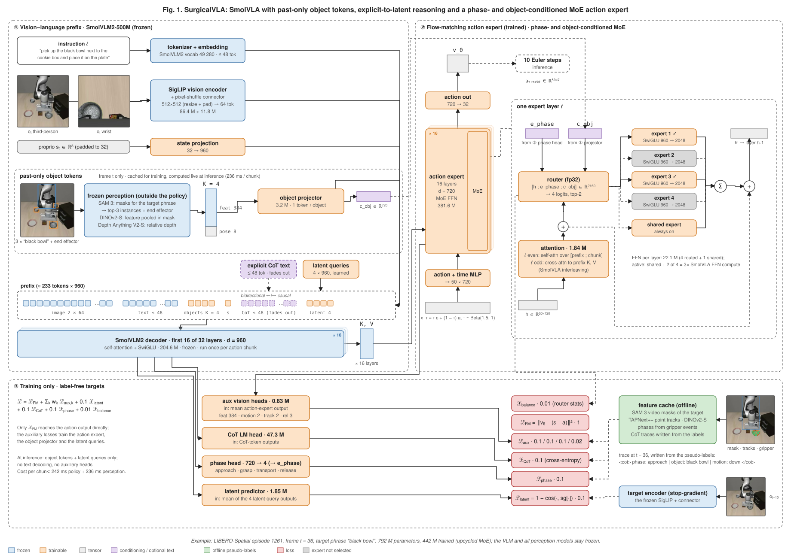
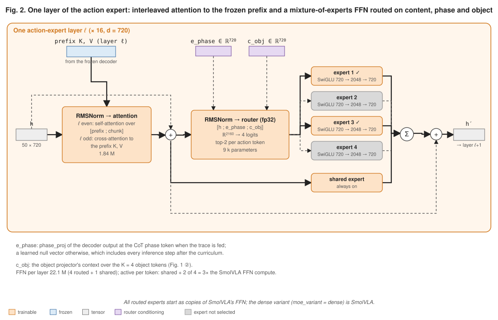
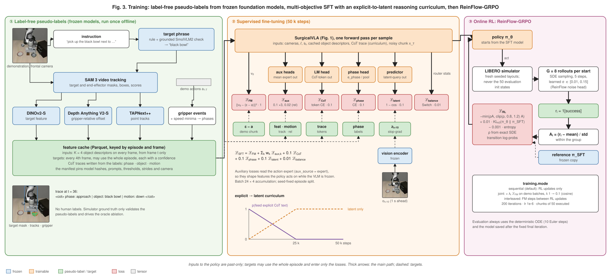

# Architecture

- **Fig. 1:** the architecture as it runs at inference.
- **Fig. 2:** one layer of the MoE action expert.
- **Fig. 3:** the training method: label-free pseudo-labels, SFT with the explicit-to-latent curriculum, then RL.

Interactive versions (hover for shapes, step through the forward pass):
[`fig/surgicalvla_arch.html`](fig/surgicalvla_arch.html),
[`fig/surgicalvla_expert_layer.html`](fig/surgicalvla_expert_layer.html),
[`fig/surgicalvla_training.html`](fig/surgicalvla_training.html).

All three are generated by [`fig/fig_surgicalvla.py`](fig/fig_surgicalvla.py) with the dl-paper-diagrams renderer. Their images are a real example, written by [`fig/fig_assets.py`](fig/fig_assets.py) from LIBERO-Spatial episode 1261 and its feature cache:
- the SAM 3 target mask;
- the object-token boxes;
- the point tracks;
- the frame 10 steps ahead;
- the reasoning trace written from the pseudo-labels.

SurgicalVLA is SmolVLA (SmolVLM2-500M truncated to 16 of 32 layers, plus a flow-matching action
expert) with switchable additions. **The final model runs with object tokens, auxiliary vision
supervision, explicit-to-latent reasoning and the MoE action expert ON**: these are the defaults
of every `configs/benchmarks/<benchmark>/sft.yaml`. Every addition keeps a config flag for the
ablations (`configs/ablations/arms.yaml`). With every flag off and `moe_variant: dense`, the
model is SmolVLA and reproduces `lerobot/smolvla_base` at initialisation (relative action error
< 2e-3, tested on the real weights). Components stay **experimental** until their ablation
passes (`docs/limitations.md`, `docs/results_analysis.md`).

## Components

| Flag (`smolvla_moe.*`) | Final default | What it adds | Supervision / source | Inference cost |
|---|---|---|---|---|
| `object_input` | `objects` | one token per object: the 3 best instances of the instruction's noun phrase + the end effector. Each token comes from a DINOv2-S feature pooled in the SAM 3 mask, plus box, centroid, relative depth and score. `grid` is the control (same encoders, 2×2 grid, no objects) | frozen perception on the **current frame only** (past-only); cached for training, computed live at inference | 236 ms per action chunk (SAM 3 + DINOv2 + Depth Anything) |
| `aux_vision` (+ `aux_source`) | on (`expert`) | heads predicting the target's DINOv2 feature, motion, point-track displacement and gripper offset | label-free pseudo-labels from the cache (may use the whole episode), confidence-weighted | none (training only) |
| `latent_cot` | on | 4 learned queries appended to the prefix; their mean output predicts the embedding of frame t+10 | the frozen vision encoder, stop-gradient (an EMA copy only when the vision encoder trains) | 4 prefix tokens |
| `use_cot` + `aux.cot_traces` | on | explicit reasoning text in the prefix, CE-trained | traces written from pseudo-labels, bootstrap round 1 unfiltered (`scripts/make_cot_traces.py`) | 1.07 s per decode every 10 chunks, but **none once the curriculum has finished** |
| `cot_curriculum_steps` | half of `run.steps` | probability of feeding explicit text decays 1 → 0; after it ends, inference is latent-only | — | as `latent_cot` |
| `moe_variant` | `upcycled` | action-expert FFN: `upcycled` (1 shared + top-2 of 4, 3× compute), `matched` (1× compute), `dense` (= SmolVLA), `dense_param_matched` | flow matching + Switch load balancing | see below |
| phase head | on with any cache | the router's phase input `e_phase` is projected from the CoT phase token when the trace is fed, and is a learned null vector otherwise, so at inference after the curriculum it carries no phase information. The phase loss classifies `e_phase` or, without a trace, the projected pooled prefix | pseudo phase segments (gripper events + speed minima) | none |
| `object_token_ablation` | `none` | evaluation probe: `zero` hides the object tokens, `shuffle` permutes their slots | — | — |
| ReinFlow noise head | RL only | learned per-step σ for SDE rollouts and exact transition log-probs | RL | none at evaluation (ODE) |

Design constraints:
- **Label-free.** Every input feature and auxiliary target comes from frozen models run
  offline on raw demonstrations. Simulator ground truth is used only to validate
  pseudo-labels and for the oracle arm.
- **Past-only inputs.** Object inputs depend on the current frame alone. A test runs the
  extractor on real frames with the future replaced and gets identical features. The reader
  never returns an input from a later frame. Targets may use the future; they only enter
  losses.
- **Frozen VLM.** The VLM's 350 M parameters stay frozen. Auxiliary targets therefore read the
  action expert (`aux_source: expert`), where they can change features the policy acts on. A
  VLM change (LoRA) is a separate study (`docs/limitations.md`).

## Cost (measured, `scripts/smoke_full_arch.py`, RTX A4500, batch 2, every component on)

| Variant | Params (trainable) | Train step | Peak VRAM (train) | Chunk latency | + live perception |
|---|---|---|---|---|---|
| `dense` | 607 M (452 M) | 0.21 s | 5.5 GiB | 117 ms | 236 ms, peak 5.9 GiB |
| `upcycled` (final) | 890 M (735 M) | 0.25 s | 7.4 GiB | 242 ms | 236 ms, peak 7.6 GiB |
| `matched` | 654 M (499 M) | 0.27 s | 5.7 GiB | 241 ms | 238 ms, peak 6.2 GiB |

The smoke test builds from `lerobot/smolvla_libero`'s config, which fine-tunes the VLM, so its trainable counts include the 16 VLM text layers. With the SFT configs' freezing (`train_expert_only: true`, frozen vision encoder) the upcycled model has 792 M parameters, of which 442 M are trained and none inside the VLM.

Measured forward cost: 0.96 TFLOP per sample (`run_info.json`). The MoE latency overhead at
equal FLOPs comes from the per-expert dispatch loop; grouped expert matmuls would remove it.

## Data flow

**Offline cache.** `scripts/make_pseudolabels.py` writes `pseudolabels/<dataset>/<cache>/`
(`docs/pseudolabels.md`):
- per-frame inputs;
- per-4th-frame targets;
- traces;
- a manifest with model hashes and settings.

**Training.** `scripts/train.py` → `Trainer._prep`:
1. processor;
2. (latent CoT) split the future frame from the observation history;
3. keep the current frame;
4. attach `aux.*` targets, phase ids, tokenised traces and `obj_*` inputs from the cache
   (`pseudolabels.reader.SidecarTargets`), by `(episode_index, frame_index)`.

The reader refuses a cache whose manifest differs from what the config expects (`aux.expect`).

**Evaluation.** `scripts/lerobot_eval.py` attaches the same perception to the policy
(`attach_live_perception`), which computes the object tokens from the current camera frame and
`batch["task"]`.
