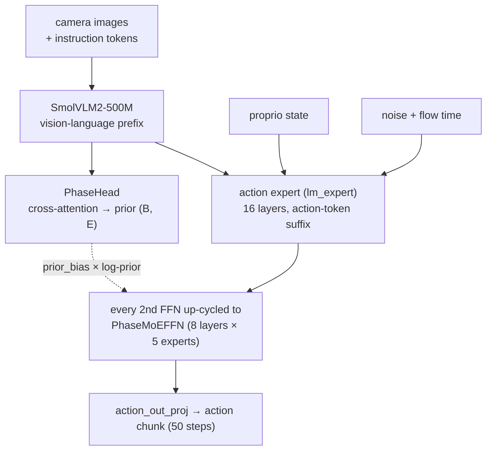
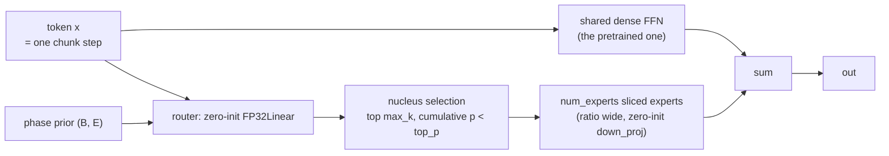

# Legacy skill-routed MoE stack (`policy_type: surgical`)

> Archived verbatim from the README as of tag `pre-audit`. This stack (`modules/policy.py`, `moe.py`, `skills.py`) is kept for reproducibility of the existing `checkpoints*/` (RoboTwin-trained). New work uses the `smolvla_moe` stack described in the README.


A **skill-routed Mixture-of-Experts Vision-Language-Action** model for robotic
surgery, built on [LeRobot](https://github.com/huggingface/lerobot) 0.6.1's
SmolVLA.

The pretrained SmolVLA stack keeps doing what it is good at — reading the
cameras and the instruction, and predicting an action chunk. On top of it we add
one thing: the action expert's feed-forward blocks become a **mixture of small
experts routed per action token**, and the routing is **biased by a
chunk-level phase prior** read from the vision-language prefix. So the same
policy can use different dynamics for "approach", "grasp" and "retract" while
still sharing one backbone.

> **Status.** Supervised training and offline evaluation are implemented and
> tested. Closed-loop online RL on LIBERO is implemented but has not been run to
> convergence — see [Online RL](#online-rl-grpo-style) and [Honest
> limitations](#honest-limitations) before trusting any number.

---

## Architecture



Each up-cycled FFN:



### Four design decisions worth knowing

**1. Routing is per token, which here means per chunk step.** The action expert
only ever sees the `chunk_size` action tokens, so one token *is* one step of the
chunk. A 50-step chunk (~1.7 s at 30 fps) can therefore switch skills
mid-chunk instead of being locked into one mixture for its whole duration.

**2. Up-cycling is an exact identity at step 0.** Each expert is a random
`ratio`-wide slice of the dense FFN's rows with a **zero-initialised**
`down_proj`, and the router is zero-initialised too. At step 0 every expert
contributes exactly zero and every router is uniform, so the model is
bit-identical to the pretrained SmolVLA it came from. Training then grows the
experts into a residual on top of the shared FFN.

**3. Two routing levels cooperate.**

| level | sees | granularity | trained by |
| --- | --- | --- | --- |
| phase prior (`PhaseHead`) | vision + language prefix | one distribution per chunk | skill cross-entropy + teacher forcing early on |
| routers (`PhaseMoEFFN.router`) | action-expert hidden state | one distribution per chunk step | skill cross-entropy on pooled logits + load balance |

The prior is what makes routing scene- and instruction-dependent; the routers
alone only ever see action-expert hidden states. The prior is added to every
token's logits, so the per-token routers can deviate from it but start anchored
to it. Early in training the prior is teacher-forced: for a decaying fraction
`p_tf` of samples the one-hot skill label is added with `tf_bias = 12` nats,
which is worth ~6× the learned logit scale.

**4. Skills are discovered from kinematics, not from labels.** A `SkillClusterer`
runs online k-means (EMA centroids, dead-cluster repair) over 8 hand-crafted
descriptors of an action chunk — mean/max/std arm speed, speed trend within the
chunk, path straightness, jerkiness, gripper activity and net travel. Those
cluster ids are the **only** supervision the router gets. See
[limitations](#honest-limitations) for what that costs.

### Losses

| term | weight | what it does |
| --- | --- | --- |
| flow-matching loss, step-weighted | `1.0` | the actual action regression; weighted by `1 + early_step_weight·exp(-t/tau)` so early chunk steps (which are executed) dominate |
| skill cross-entropy | `skill_loss_coef` | pooled router logits vs. kinematic cluster labels, label smoothing `skill_label_smoothing` |
| router z-loss | `moe_z_coef` | `logsumexp(logits)²`, keeps router logits small |
| load balance | `moe_load_balance_coef` | standard Switch-Transformer `E · Σ_e f_e · P_e` with detached dispatch fraction `f` |

Auxiliary terms are **summed** into the flow loss, not averaged, so their
coefficients are absolute.

### Action representation

Actions are regressed as a **delta** relative to the current state on the arm
dimensions (`delta_actions: true`) and as the raw command on the gripper
dimensions (`gripper_dims`). `_model_target()` is the single place that defines
this transform, and both the regression target and the skill descriptors are
computed through it — so cluster kinematics are computed on exactly the quantity
the model is asked to produce.

The action head (`action_out_proj`) is forced to float32 (`fp32_action_head`)
because the final projection is tiny and bf16 there measurably hurts.

---

## Install

Everything Python-side is declared once, in `pyproject.toml`. [pixi](https://pixi.sh)
provides the interpreters and resolves the four environments:

| environment | Python | contains | use for |
| --- | --- | --- | --- |
| `default` | 3.13 | `lerobot[smolvla,dataset]==0.6.1`, torch, wandb, the package (editable) | training, evaluation, RL |
| `dev` | 3.13 | `default` + pytest + ruff | tests and lint |
| `asr` | 3.13 | `default` + faster-whisper + sounddevice | live microphone command recognition |
| `libero` | 3.10 | robosuite 1.4 + LIBERO, numpy 1.22 | the LIBERO simulator server |

The split exists because LeRobot 0.6.1 needs Python ≥ 3.12 while LIBERO pins
numpy 1.22 / robosuite 1.4 / gym 0.25, which only work on 3.10. The simulator
runs in its own process and talks to the trainer over a socket — it never
imports torch.

The local LeRobot checkout is installed with only the `dataset` and `smolvla`
extras. Do not switch it to `all`: that pulls in `dm-control` → `labmaze`, which
has no Python 3.13 wheel and whose sdist shells out to Bazel (and fails on
`bazel_skylib` with modern Bazel). None of the simulator extras are needed here.

```bash
pixi install                 # default env
pixi install -e dev          # + pytest/ruff
pixi install -e libero       # simulator env (then run scripts/setup_libero.sh)
```

Anything with a Python entry point is run through pixi:

```bash
pixi run -e default python scripts/train.py --help
pixi run -e dev pytest
```

`pixi run` sets `PYTHONNOUSERSITE=1` and clears `PYTHONPATH` for the `libero`
env, because the machine's system Python 3.10 user-site and the ROS humble
`PYTHONPATH` both shadow the pinned numpy/robosuite stack.

---

## Data

Any LeRobot dataset (local directory or Hub repo) works; the codebase version is
LeRobot's problem, not ours. Frame windows come from
`config.observation_delta_indices` / `action_delta_indices` and the dataset's own
`fps`.

Two dataset-side settings live in `configs/train.yaml`:

```yaml
dataset:
  root: "/path/to/lerobot/dataset"     # null -> resolve repo_id from the Hub
  camera_map:                          # dataset key -> config key
    observation.images.cam_high: observation.images.top
    observation.images.cam_left_wrist: observation.images.left_wrist
    observation.images.cam_right_wrist: observation.images.right_wrist
```

Camera keys that have no `camera_map` entry pass through unchanged, with a
warning — if you load a pretrained checkpoint, they must match the checkpoint's
feature names exactly or the policy will not find them in the batch.

Episode-level train/val split is generated once (seeded by `dataset.split_seed`)
and cached as `<output_dir>/split.json`, so training and evaluation always agree
on which episodes are held out.

---

## Training

```bash
pixi run -e default python scripts/train.py \
  --config configs/train.yaml \
  --repo_id myorg/my_surgical_dataset
```

| flag | meaning |
| --- | --- |
| `--config` | YAML config (required) |
| `--repo_id` | LeRobot dataset id; any string when the data is local-only |
| `--root` | local dataset directory (overrides `dataset.root`) |
| `--pretrained` | SurgicalVLA checkpoint directory to fine-tune from |
| `--resume` | checkpoint directory, or `latest` to pick the newest `step_N` under `<output_dir>/checkpoints` |
| `key=value ...` | dotlist overrides, e.g. `model.chunk_size=25 moe.moe_max_k=1` |

Resuming restores optimizer, scheduler, EMA, step counter and the W&B run id, and
fast-forwards the dataset iterator to the right place. With `--pretrained` (but
not `--resume`) the skill clusters are re-fitted on the new dataset, because
"what a skill is" changes with the platform.

### What gets logged

Every `project.log_every` steps: `loss`, `losses_after_rm_padding`, `grad_norm`,
`lr`, `gpu_mem_gb`, `skill_ce`, `skill_acc`, `route_entropy`,
`moe_load_balance`, `moe_z`.

Every `project.val_every` steps: the same losses re-computed on the held-out
episodes with a **fixed** noise/time seed, plus `mae_arm`, `mse_arm`, `mae_grip`,
per-chunk-position MAE buckets (`mae_h0_10`, `mae_h10_25`, `mae_h25_50`), and
`jitter_pred` / `jitter_gt` (second-difference magnitude — how smooth the
predicted chunk is versus the demonstration). Validation runs twice: the live
model and the EMA shadow (`val/` and `val_ema/`).

Per-MoE-layer expert utilisation is written as scalars and as a heatmap; action
chunks are plotted against ground truth; camera frames are gridded. Everything is
in TensorBoard (`<output_dir>/logs`), W&B, and as PNGs in
`<output_dir>/figures/`.

---

## Evaluation

```bash
pixi run -e default python scripts/evaluate.py \
  --checkpoint checkpoints/checkpoints/step_8000 \
  --repo_id myorg/my_surgical_dataset \
  --modes on off oracle --num_steps 10
```

`--modes` compares routing regimes on the same batches:

* `off` — the dense pretrained FFN only (the baseline the MoE must beat),
* `on` — learned per-token routing,
* `oracle` — the skill label forced as the mixture, i.e. the ceiling for the
  router's supervision signal.

`--num_steps` is the number of flow-matching integration steps; `--ema` swaps in
the EMA shadow weights; `--subset {val,train,all}` picks the episodes. Results go
to JSON plus per-step plots under `--out` (default `eval_results/`).

**Ablate, don't assume.** If `on` does not beat `off`, the experts are not
earning their parameters, whatever the routing statistics look like.

---

## LIBERO simulator

```bash
pixi install -e libero
scripts/setup_libero.sh          # clone, config, macros, editable install, smoke test
```

The script is idempotent and covers four things that bite on a fresh machine:

1. it writes `~/.libero/config.yaml`, because importing `libero` otherwise
   **prompts on stdin** and hangs any headless run;
2. it runs robosuite's `setup_macros.py` non-interactively (it also prompts when
   a private macro file already exists);
3. it installs LIBERO editable with `--config-settings editable_mode=compat`,
   because `libero/libero/` is a namespace directory with no `__init__.py`, so
   `find_packages()` returns nothing and a modern PEP 660 finder maps zero
   modules;
4. it smoke-tests `OffScreenRenderEnv` without importing torch (torch is
   deliberately **not** installed in the `libero` env).

LIBERO's `.pruned_init` files are `torch.save` output holding plain numpy
arrays, so they load without torch:

```python
import pickle, zipfile
with zipfile.ZipFile(init_file) as z:
    init_states = pickle.loads(z.read("archive/data.pkl"))   # ndarray, (50, 123)
```

---

## Online RL (GRPO-style)

`scripts/train_rl.py` runs closed-loop rollouts in LIBERO and updates the policy
from **group-relative advantages**. The simulator lives in the `libero` pixi env;
the trainer lives in `default`; they talk over a local TCP socket carrying
JSON lines with zlib-compressed uint8 frames.

```bash
# terminal 1 (or let train_rl.py spawn it)
pixi run -e libero python scripts/libero_server.py --port 0

# terminal 2
pixi run -e default python scripts/train_rl.py \
  --config configs/rl.yaml \
  --pretrained checkpoints/checkpoints/step_8000 \
  --suite libero_10
```

### Why not a verbatim GRPO / verl port

GRPO and verl are built for causal LMs: they need a per-token log-probability of
the sampled sequence and an importance ratio between the sampling and training
policies. A flow-matching action head is a *continuous ODE*, so the
log-likelihood of a sampled 50×D chunk is not available at reasonable cost, and
there is no token vocabulary to renormalise over.

What is implemented instead is the same recipe applied to quantity we can
actually compute — **group-relative advantage weighted flow matching**:

1. for one task, roll out `group_size` episodes with **stochastic sampling**
   (fresh noise per chunk, so the group is a genuine sample from the policy),
2. reward `r_i` = sparse task success plus small shaping terms,
3. advantage `A_i = (r_i − mean_{j≠i} r_j) / (std_{j≠i} r_j + ε)` — leave-one-out,
   so an all-success or all-failure group produces no gradient,
4. minimise `A_i · L_flow(episode_i)`: positive-advantage episodes get their
   flow loss pushed down, negative-advantage episodes get it pushed up,
5. add `kl_coef · ||pred − pred_ref||²` against a frozen reference copy of the
   policy on the same states, as a cheap action-space KL proxy.

Step 5 is a proxy, not a KL divergence, and there is no importance ratio. This is
honest to call **GRPO-style**, and the config says so.

### Real-time validation

Every `rl.val_every` iterations the trainer runs a **fixed** set of held-out
tasks/episodes deterministically (`n_action_steps` per chunk, greedy flow
sampling) and streams, per iteration:

* `rl/val_success_rate`, `rl/val_reward`, `rl/val_episode_len`,
* `rl/train_success_rate`, `rl/train_reward`, `rl/advantage_std`,
* `rl/val_action_mae` where a ground-truth chunk exists,
* per-skill expert usage and routing entropy from the rollout itself.

plus a rolling success-rate figure and the first frame of each validation episode
as an image panel — so you can watch the curve move in W&B while it trains
instead of waiting for a final number.

---

## Tests

```bash
pixi run -e dev pytest
```

`PYTEST_DISABLE_PLUGIN_AUTOLOAD=1` is needed on machines that have ROS installed,
otherwise pytest tries to load `launch_testing` plugins and fails on a missing
`lark`:

```bash
PYTEST_DISABLE_PLUGIN_AUTOLOAD=1 PYTHONPATH=src pixi run -e dev pytest tests -q
```

`tests/test_moe.py` is the regression gate for the MoE layer: up-cycling identity,
nucleus selection, load-balance behaviour, expert slicing, auxiliary losses, and
skill-cluster descriptor/EMA/dead-cluster behaviour — all without needing LeRobot
or a GPU.

---

## Repository layout

```
SurgicalVLA/
├── configs/
│   ├── train.yaml               # supervised run: model, moe, dataset, logging
│   └── rl.yaml                  # online RL run: rollouts, GRPO, LIBERO
├── scripts/
│   ├── train.py                 # supervised entry point
│   ├── evaluate.py              # on/off/oracle comparison
│   ├── train_rl.py              # GRPO-style online RL
│   ├── libero_server.py         # simulator process (runs in the `libero` env)
│   ├── setup_libero.sh          # idempotent LIBERO installer
│   └── debug.py                 # one-batch forward, prints routing diagnostics
├── src/surgicalvla/
│   ├── modules/
│   │   ├── policy.py            # SurgicalVLAConfig, SurgicalFlowMatching, SurgicalVLAPolicy
│   │   ├── moe.py               # RouteState, SlicedExpert, PhaseMoEFFN, aux losses
│   │   ├── skills.py            # SkillClusterer, PhaseHead
│   │   └── nn.py                # FP32Linear
│   ├── data/dataset.py          # LeRobot dataset + camera-key renaming
│   ├── training/trainer.py      # fit / validate / logging
│   ├── rl/                      # socket protocol, env client, rollouts, GRPO
│   └── utils/                   # logging, metrics, EMA, splits, ASR sidecar
└── tests/test_moe.py
```

---

## Config reference

### `model` — `SurgicalVLAConfig`

| key | default | meaning |
| --- | --- | --- |
| `vlm_model_name` | SmolVLM2-500M-Video-Instruct | backbone |
| `chunk_size` | 50 | action tokens per chunk |
| `n_action_steps` | 25 | steps actually executed before re-planning |
| `n_obs_steps` | 1 | observation history length |
| `num_vlm_layers` | 16 | layers in the action expert |
| `expert_width_multiplier` | 0.75 | action expert width vs. VLM width |
| `freeze_vision_encoder` | true | keeps the ViT frozen |
| `train_expert_only` | true | only the expert + heads are optimised |
| `load_vlm_weights` | true | load pretrained SmolVLM weights |
| `delta_actions` | true | regress `action − state` on arm dims |
| `fp32_action_head` | true | final projection in float32 |
| `gripper_dims` | `[6]` | dims exempt from the delta transform |
| `early_step_weight` / `early_step_tau` | 1.0 / 10.0 | chunk-step loss weighting |
| `uniform_time_mix` | 0.3 | fraction of uniform (vs. beta) flow times |

### `moe` — routing

| key | default | meaning |
| --- | --- | --- |
| `num_experts` | 8 | experts per MoE layer |
| `moe_every_n_layers` | 2 | up-cycle every n-th FFN (so 8 of 16 layers) |
| `moe_expert_ratio` | 0.25 | expert width as a fraction of the dense FFN |
| `moe_max_k` | 2 | max experts per token |
| `moe_top_p` | 0.7 | nucleus threshold |
| `moe_prior_bias` | 1.0 | weight of the phase prior on each router |
| `moe_load_balance_coef` | 0.01 | Switch-Transformer load balance |
| `moe_z_coef` | 1e-3 | router z-loss |
| `skill_loss_coef` | 0.1 | skill cross-entropy |
| `skill_label_smoothing` | 0.1 | label smoothing for that CE |
| `skill_ema` | 0.99 | centroid EMA |
| `skill_freeze_steps` | 2000 | stop updating clusters after this many steps |

### `project` / `run` / `logging`

`project.*` is W&B and cadence (`log_every`, `val_every`, `save_every`);
`run.*` is steps, batch size, device, streaming, `grad_accum`, `amp`,
`val_samples`, `ema_decay`; `logging.*` is the visual panel cadence. Checkpoints
are written to `<run.ckpt_dir>/checkpoints/step_N` via
`save_pretrained`, with a sibling `trainer_state.pt` holding optimizer,
scheduler, EMA, step and W&B run id.

---

## Honest limitations

These are real and worth reading before quoting a number:

1. **Skill labels are kinematic only.** The 8 descriptors are computed from the
   action chunk alone, so the clusters are motion primitives, not semantic
   surgical phases. Two visually different tasks that move the arm the same way
   get the same label; the router's only supervision therefore cannot separate
   them. The `PhaseHead` *does* see vision and language, so its prior can in
   principle separate them — but it is trained toward the kinematic labels, so
   nothing in the current objective rewards that. Real phase labels (or a
   vision-based clusterer) would be the upgrade.
2. **The router's supervision is one chunk-level distribution.** The CE is
   computed on logits pooled over chunk steps, while the per-token switches are
   free. Mid-chunk specialisation is therefore unverified; it is an
   architectural affordance, not a demonstrated behaviour.
3. **Evaluation is offline.** `on`/`off`/`oracle` compare chunk MAE on held-out
   demonstrations. That measures regression, not task success. Closed-loop
   LIBERO is the check that matters, and it is wired but not yet run to
   convergence.
4. **The online RL objective is not GRPO.** It is group-relative
   advantage-weighted flow matching with an action-space KL proxy — no
   importance ratio, no per-step log-probabilities. See
   [Online RL](#online-rl-grpo-style).
5. **RL on LIBERO needs a 7-D action space.** LIBERO is a single arm with
   `OSC_POSE` (Δpos, Δrot, gripper) actions. A bimanual 14-D checkpoint's first
   seven dimensions will run, but they were not trained for this robot or this
   controller; expect it to fail until the policy has seen 7-D data.

---

## Licence

MIT.
